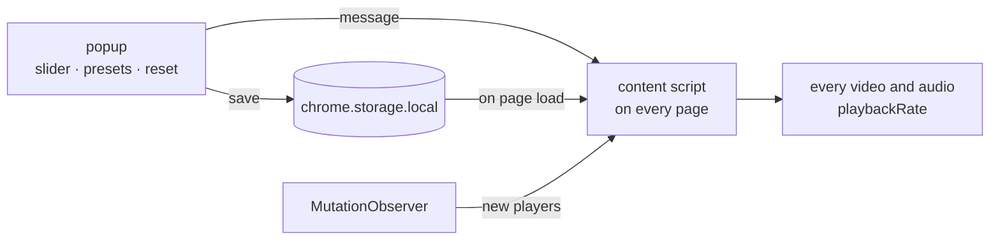

  

  <b>Every video on the web, at the speed you actually want to watch it.</b> 
  A small Chrome extension that sets the playback speed of any video or audio on any page, remembers it, and keeps applying it to players that load later.

  
    <a href="#overview">OVERVIEW</a> &nbsp;·&nbsp;
    <a href="#install">INSTALL</a> &nbsp;·&nbsp;
    <a href="#how-it-works">HOW IT WORKS</a> &nbsp;·&nbsp;
    <a href="#releases">RELEASES</a> &nbsp;·&nbsp;
    <a href="#privacy">PRIVACY</a>
  

 

<table>
  <tr>
    <td>PLATFORM <b>Chrome, Manifest V3</b></td>
    <td>RANGE <b>0.1× to 16×</b></td>
    <td>PRESETS <b>0.25 · 0.5 · 1 · 1.5 · 2</b></td>
    <td>PERMISSIONS <b>activeTab, storage</b></td>
    <td>DEPENDENCIES <b>None</b></td>
  </tr>
</table>

## Overview

Most sites cap playback at 2× and forget your choice on the next page. This extension does neither. Pick a speed once with the slider or a preset, and it is applied to every `<video>` and `<audio>` element on every site from then on, including players that appear after the page has loaded, like YouTube's.

## Install

1. Download the latest `.zip` from [Releases](https://github.com/kelyonn/video-speed-controller/releases) and unzip it, or clone this repository.
2. Open `chrome://extensions/` and turn on **Developer mode**.
3. Click **Load unpacked** and choose the folder.

> [!TIP]
> After changing the code, press the refresh button on the extension's card in `chrome://extensions/` to reload it.

## How it works

| File | Role |
|---|---|
| `popup.html` · `popup.js` · `style.css` | The control: slider, presets, reset to 1× |
| `content.js` | Sets `playbackRate` on every media element, reads the saved speed on load, and watches the DOM for new players |
| `background.js` | Service worker for the install event |
| `manifest.json` | Manifest V3 configuration |

## Releases

Every push to `main` runs a GitHub Actions workflow that packages the extension into a `.zip` and publishes a release tagged with the version in `manifest.json`. `package.sh` does the same locally. Details in [DEPLOYMENT.md](DEPLOYMENT.md).

## Privacy

No account, no analytics, no network requests. The only thing stored is your chosen speed, in Chrome's local extension storage.

MIT.
